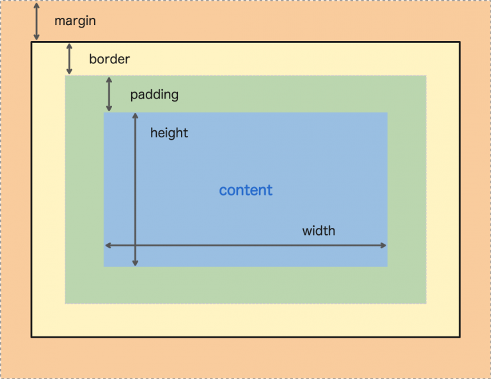

# Intro to CSS - Box Model


**Learning objective:** By the end of this lesson, students will be able to use the CSS box model to control the size, appearance, and spacing of elements on web pages.

Everything in CSS is a box. The CSS box model is a way to visualize the space that each element takes up on the page. The box model is made up of 4 parts: **content, padding, border, & margin**.



## Content

The content of the box, where text and images appear.

## Padding

The [padding](https://developer.mozilla.org/en-US/docs/Web/CSS/padding) is the space between the content and the border. 

Padding can be added to any side of an element, and it can be different thicknesses on different sides. Padding is useful for creating space between the content of an element and its border or margin. 

Adjusting the padding will shift the content of the box, but will not impact neighboring elements.

The value of the padding property can be displayed in a number of ways:

When we use a single value, it gets applied to all four sides:

```css
p {
  /* all four sides */
  padding: 2px;
}
```

When we use two values, the first applies to the top and bottom, and the second applies to the left and right:

```css
p {
  /* top & bottom | left & right */
  padding: 2px 4px;
}
```

With three values, they are applied to the top, left + right, and bottom, respectively:

```css
p {
  /* top | left & right | bottom */
  padding: 2px auto 4px;
}
```

Lastly, four separate values affect the top, right, bottom, and left margins in that order:

```css
p {
  /* top | right | bottom | left */
  padding: 2px 1px 4px 7px;
}
```

## Border

The [border](https://developer.mozilla.org/en-US/docs/Web/CSS/border) is a solid line that surrounds the padding area. Borders can be different colors, widths, and styles. Borders are useful for separating elements from each other and for adding visual interest to a web page.

We can set the value of the border's width, style, and color:

```css
div {
  border: 3px solid red;
}
```

## Margin

The [margin](https://developer.mozilla.org/en-US/docs/Web/CSS/margin) is the space between the border and other elements.

Margins can be added to any side of an element, and they can be different thicknesses on different sides. Margins are useful for creating space between elements and for controlling the overall layout of a web page.


We can manipulate the value of the margin property the same way as the padding property:

One value

```css
p {
  /* all four sides */
  margin: 2px;
}
```
Two

```css
p {
  /* top & bottom | left & right */
  margin: 2px 4px;
}
```

Three

```css
p {
  /* top | left & right | bottom */
  margin: 2px auto 4px;
}
```

Four

```css
p {
  /* top | right | bottom | left */
  margin: 2px 1px 4px 7px;
}
```

### Other ways to target padding and margin

You can also target a specific side of a box's padding or margin like this:

```css
p {
  padding-bottom: 1px;
  padding-left: 2px;
  padding-right: 3px;
  padding-top: 4px;
}
```

