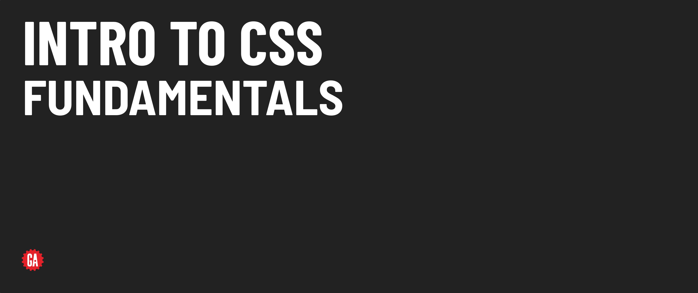
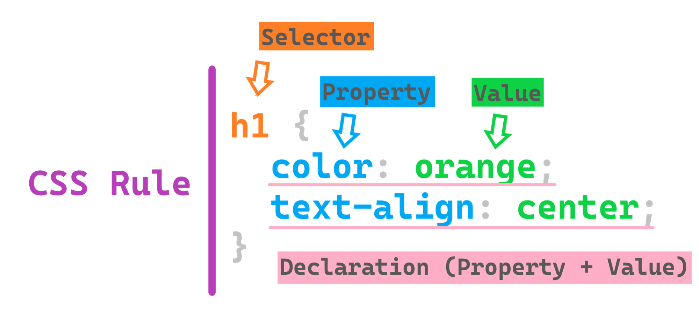

# Intro to CSS - Fundamentals



**Learning objective:** By the end of this lesson, students will be able to learn the fundamentals of CSS syntax, comments, and element selectors to style web pages.

## Syntax

The following graphic shows the basic syntax of a CSS rule:



Let’s discuss the individual components above:

**Selectors**: Used to target the element(s) to be styled and range from simple to incredibly complex. Multiple selectors can be specified, in which case commas separate them. 

**Properties**: There are a few hundred CSS properties that can be used to style the color, size, text, position, border, animation, and more, of elements.

**Value**: The value to apply to a property is, of course, specific to that property. For example, the CSS property, *font-family*, accepts values of names of fonts such as *Georgia*, *Helvetica*, and so on. Other properties may have numeric values and a type of unit assigned to them; for example, you might set the width of a border to *5px*.

**Declaration**: The combination of a *property* and *value*, separated by a colon and ending with a semi-colon, makes a declaration.

## Comments

Just like comments in JavaScript and HTML, we use CSS comments to explain and document our CSS code. These comments are ignored by browsers, so they don't affect the appearance of our web pages. 

Comments are a great tool and can be incredibly helpful for other developers trying to understand our code, or even for ourselves when we revisit projects later. 

Unlike JavaScript, there is only one type of comment in CSS, and it follows the syntax of a **JavaScript multi-line comment**.

CSS comments start with a forward slash and an asterisk `/*` and end with an asterisk and a forward slash `*/`. They can span multiple lines or one line, but they need both the opening and closing tags. 

```css
p {
  color: green; /*This is a single line comment*/
}

/* 
This is 
a multi-line
comment.
*/
```

We can also comment out chunks of our CSS code:

```css 
/*
h1 {
  color: red;
}
*/
```

## Element selectors

CSS element selectors are used to target every instance of a specific HTML element on a web page.

For example, we could select all `<h1>` and `<h2>` tags like this:

```css
h1, h2 {
  ...
}
```

### 💪 **You Do**:

In your `style.css` file:
  - Set the margin on `<body>` element to 0 on all four sides (this is a common reset we have to do on all our pages because most browsers give a margin to the body element, which we usually do not want.)
  - Also, give the background of the `<body>` element a color of `lightgray` and a height of `200px`.
  - Set the margin on the `<ul>` elements to 0 on all four sides as well.
  - Set the text color of all `<div>` elements to `blue`.

